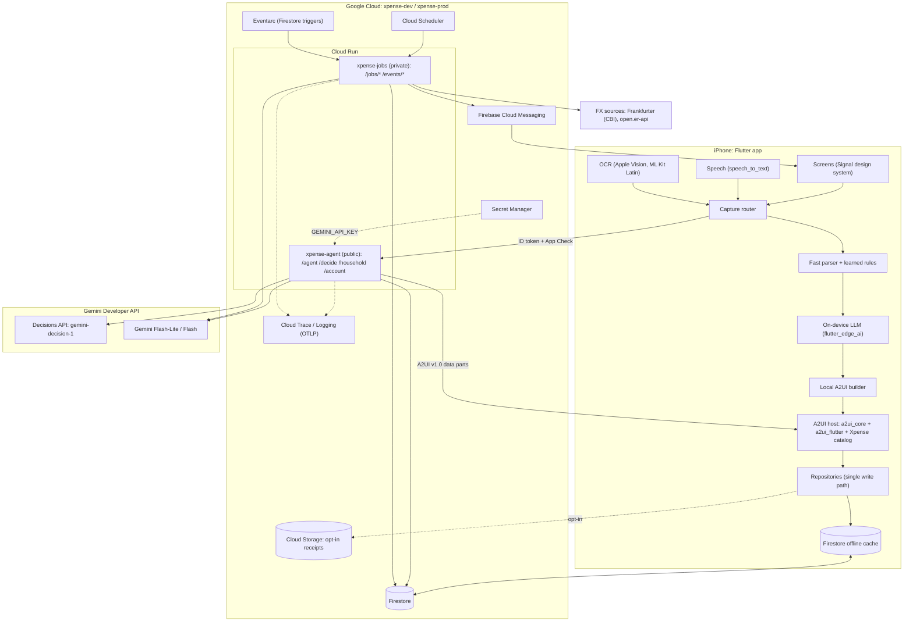
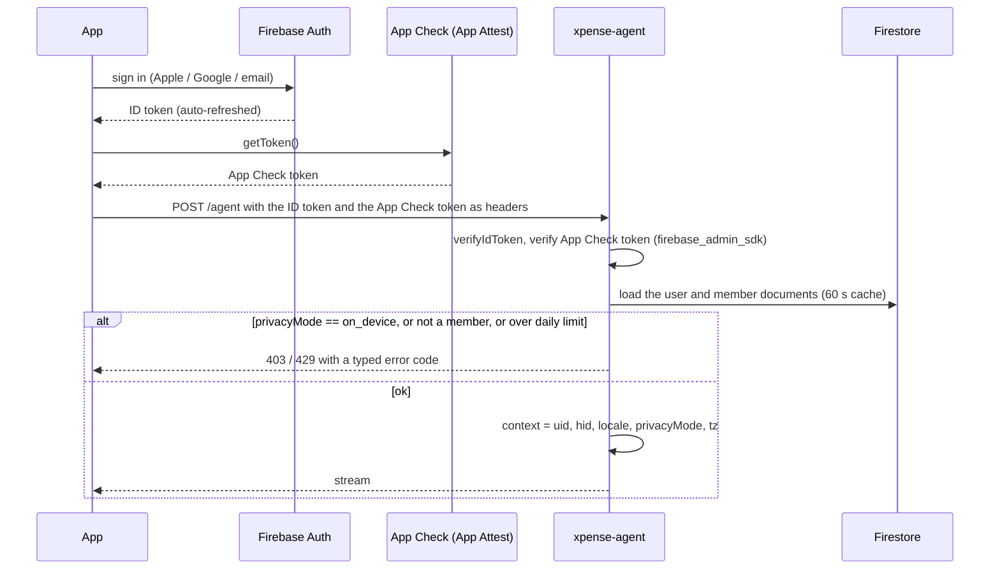
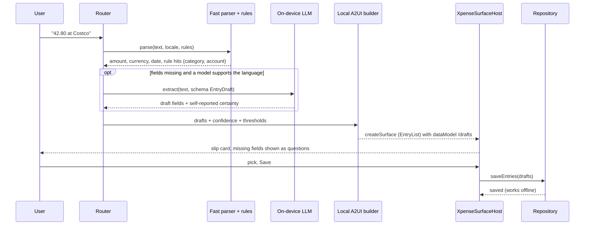
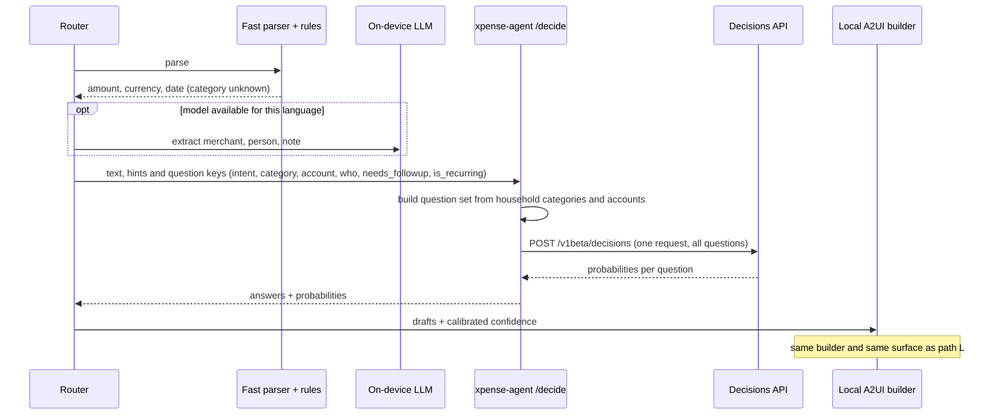
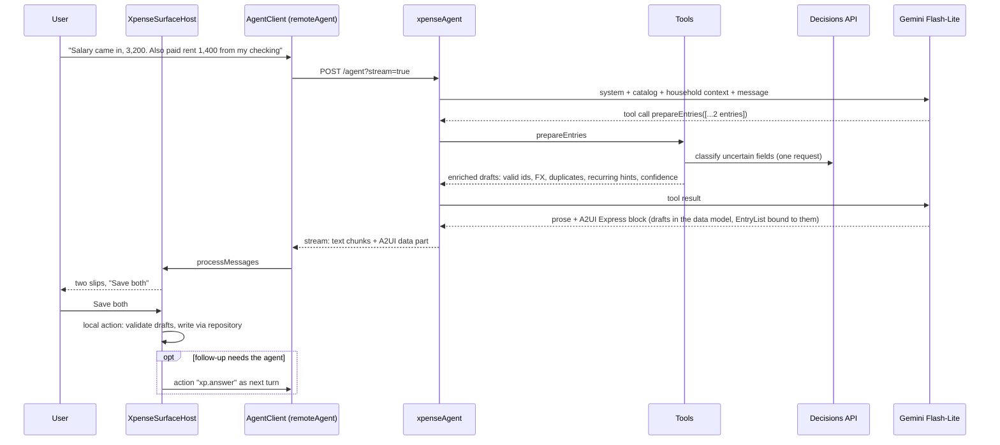
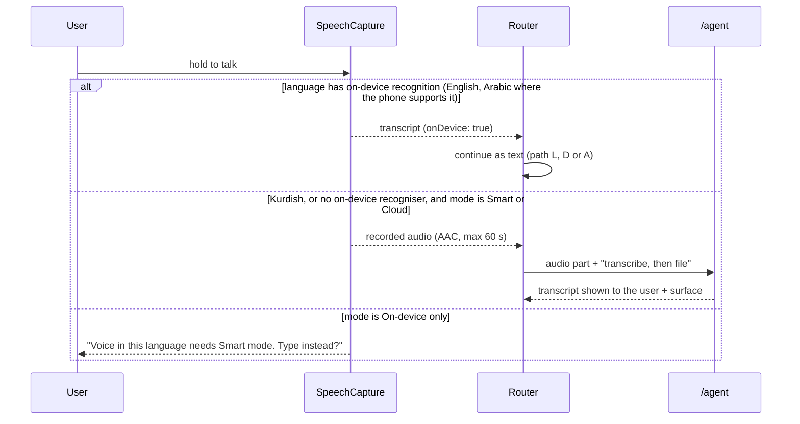
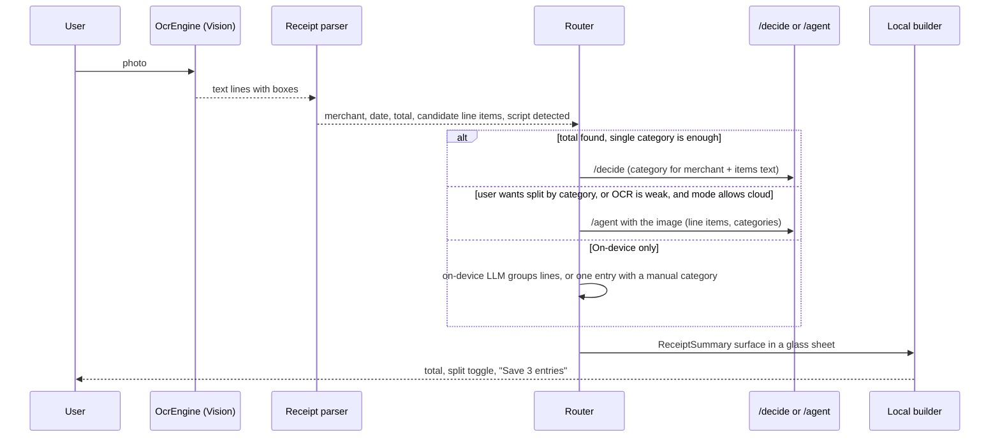
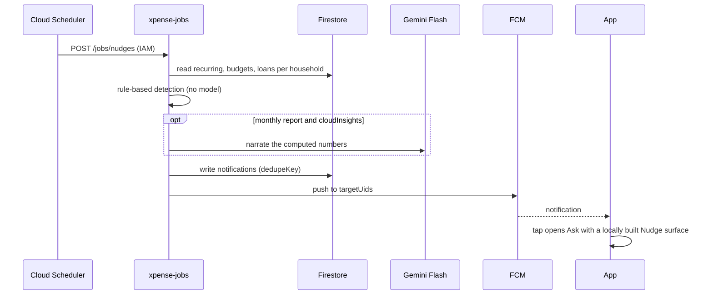
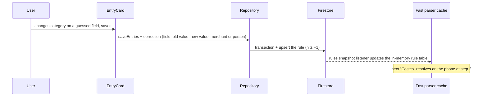
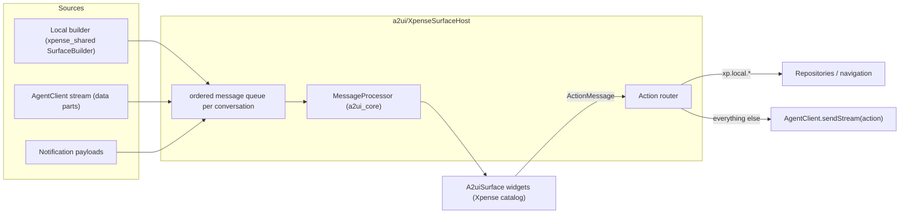

# Family Xpense: Architecture

Locked shape from the brief, detailed here. `D-nn` references are in [DECISIONS.md](DECISIONS.md). Versions and what was checked are in DECISIONS section 3.

## 1. System diagram



## 2. Repository layout

```
app/                       Flutter app (package xpense_app)
server/                    Dart service (package xpense_agent), one image, two Cloud Run services
packages/xpense_shared/    pure Dart: money, FX, digits, fast parser, schemas, taxonomy, catalog JSON, surface builder
firebase/                  firestore.rules, indexes, storage.rules, emulator config, rules tests
evals/                     datasets (JSONL), receipt fixtures, expected outputs
docs/
.github/workflows/
.fvmrc                     Flutter 3.50.1
```

- `app` and `server` each depend on `xpense_shared` by path and keep **separate lockfiles**. A pub workspace is not used: `a2ui_flutter 0.4.0` needs `a2ui_core ^0.8.0` while `genkit_a2ui 0.6.0` needs `a2ui_core ^0.7.0`, and a workspace forces one resolution (D-05).
- `xpense_shared` must not depend on `a2ui_core`, Flutter, `dart:io` or Firebase. Allowed: `schemantic`, `decimal`, `clock`, `meta`, `collection`.

## 3. Flutter app

### 3.1 Modules

Feature-first. A feature owns its screens, its view model (one Riverpod `Notifier` per screen) and nothing else. Dependencies point downward only.

```
app/lib/
  main.dart, bootstrap.dart, app.dart
  core/            theme tokens + ThemeExtensions, GlassSurface, formatting (money, dates, digits), l10n, routing, errors (Result/Failure)
  data/            Firestore repositories, DTO mapping, offline queue, local receipt store
  services/        interfaces + implementations for everything native or remote (table 3.2)
  a2ui/            Xpense catalog widgets, XpenseSurfaceHost (adapter), local surface feeding, action routing
  features/
    onboarding/  household/  accounts/  capture/  ask/  activity/
    goals/  loans/  budgets/  insights/  settings_privacy/  home/  notifications/
```

| Layer | May import | Must not import |
|---|---|---|
| `features/*` | `core`, `data` (repository interfaces), `services` (interfaces), `a2ui` (host widget only) | another feature, `cloud_firestore`, `genkit`, `a2ui_core` |
| `a2ui/` | `core`, `a2ui_core`, `a2ui_flutter`, `xpense_shared` | features, Firestore |
| `data/` | `xpense_shared`, Firebase packages | features, Flutter widgets |
| `services/` | plugin packages | features |
| `core/` | Flutter, `xpense_shared` | everything above |

A grep-based CI test enforces these import rules.

`home` and `notifications` are added to the brief's module list: Home is its own screen, and the notifications centre is a v1 requirement (D-20).

### 3.2 Service boundaries (everything pre-1.0 or native sits behind one)

| Interface (in `services/`) | Wraps | Why wrapped |
|---|---|---|
| `AgentClient` | `remoteAgent` from `package:genkit/experimental_client.dart` | experimental API |
| `DecisionsClient` | `POST /decide` | beta API, may be swapped |
| `OnDeviceLlm` | `flutter_edge_ai` + `flutter_edge_ai_builtin_ai` + `flutter_edge_ai_litertlm` | fast-moving package, engines differ by device |
| `SpeechCapture` | `speech_to_text` (on-device flag), `record` for raw audio | platform limits per language |
| `OcrEngine` | Apple Vision via a platform channel; `google_mlkit_text_recognition` for Latin and Android | ML Kit has no Arabic script (D-08) |
| `GlassSurface` (widget, in `core/`) | `liquid_glass_widgets` | shader package, needs fallbacks |
| `AccessibilityFlags` | platform channel for Reduce Transparency; `MediaQuery` for the rest | Flutter does not expose Reduce Transparency |
| `BiometricLock` | `local_auth` | |
| `SecureStore` | `flutter_secure_storage` | |
| `Clock` | `package:clock` | testable time |
| `XpenseSurfaceHost` (in `a2ui/`) | `MessageProcessor`, `A2uiSurface` | pre-1.0 renderer |

### 3.3 State, routing, startup

- **State:** Riverpod 3. Repositories expose streams; view models are `Notifier`/`AsyncNotifier`. No other DI container.
- **Routing:** `go_router` with a `StatefulShellRoute` for the four tabs (Home, Activity, Goals, Accounts). Ask is a full-height route pushed above the shell, opened by the round glass button. Deep links: `xpense://ask?text=…`, `xpense://join?code=…`, `xpense://txn/{id}`, `xpense://loan/{id}`.
- **Startup order:** error handlers → Firebase init → App Check activate → settings and theme restore (before first paint) → `runApp` with provider overrides → post-frame: Remote Config fetch, on-device model probe, rule cache sync.
- **Lock:** when Face ID lock is on, a lock overlay covers the app on cold start and after 60 s in background. Content is blurred in the app switcher.

### 3.4 Write path

All user-confirmed writes go through repositories on the phone, including entries proposed by the cloud agent (D-10). The agent never writes transactions for a chat turn. Reasons: saves work offline, one code path for both AI paths, Firestore rules stay the enforcement point, and injected text cannot make the server write money data.

Server-side writes are limited to: joining a household, recurring posts in `auto` mode, notifications, FX rates, reconcile corrections, visibility backfill, usage counters, deletion.

## 4. Backend

### 4.1 One image, two services (D-17)

| Service | Ingress | Serves | Auth |
|---|---|---|---|
| `xpense-agent` | public | `/agent`, `/decide`, `/household/*`, `/account/*`, `/healthz` | Firebase ID token + App Check, verified in the context provider |
| `xpense-jobs` | IAM-private (`--no-allow-unauthenticated`) | `/jobs/*`, `/events/*` | Cloud Run IAM: only the scheduler and Eventarc service accounts hold `run.invoker` |

Same container, `XPENSE_ROLE=agent|jobs` selects which routes mount. Region `me-central1` (Doha) for both, Firestore and Storage (D-18, chosen by the owner).

### 4.2 Endpoints

| Route | Kind | Purpose |
|---|---|---|
| `POST /agent` (+ `/agent/getSnapshot`, `/agent/abort`) | Genkit agent `xpenseAgent`, streams with `?stream=true` | Multi-entry, ambiguity, questions, audio and image turns, follow-up dialogue. Emits A2UI v1.0 through `a2ui(catalog: 'xpense')`. |
| `POST /decide` | Genkit flow `decide` | Proxy to the Decisions API. Builds the question set from household data server-side; the phone sends text and a list of question keys. |
| `POST /household/join` | flow | Validates an invite code, adds the member, updates `memberIds`. |
| `POST /household/invite` | flow | Creates an invite, returns the code and link. |
| `POST /account/delete` | flow | App Store account deletion. |
| `POST /jobs/fx-rates` | job, daily 06:00 Baghdad | Fetch official rates, write `fxRates/{day}`. |
| `POST /jobs/recurring` | job, daily 07:00 | Detect recurring patterns, post `auto` items, queue reminders. |
| `POST /jobs/nudges` | job, daily 08:00 | Budget warnings, loan due dates, missed bills, stale market rate. |
| `POST /jobs/monthly-report` | job, 1st of month | Build summary; narrate with Flash when `cloudInsights` is true, else template. |
| `POST /jobs/reconcile` | job, nightly | Recompute balances and loan totals. |
| `POST /jobs/retention` | job, weekly | Delete old sessions, invites, usage. |
| `POST /events/account-visibility` | Eventarc, `accounts/*` updated | Backfill `visibleTo` on transactions. |
| `POST /events/transaction-written` | Eventarc, `transactions/*` written | Near-real-time budget threshold check. |

`/household/*` and `/account/*` are additions to the brief's three route groups; they need admin rights that rules cannot grant safely (D-19).

All public routes are mounted under a version prefix (`/v1/agent`, `/v1/decide`, …). The prefix is tied to the Xpense catalog version, because installed apps lag behind the server: a breaking catalog change ships as `/v2` with its own agent definition while `/v1` keeps serving older apps. Routes are written without the prefix elsewhere in these documents.

### 4.3 Server modules

```
server/
  bin/server.dart               GenkitRouter wiring, role switch, serve()
  lib/
    genkit.dart                 Genkit instance: googleAI(), A2uiPlugin(); model refs from config
    runtime/                    ONLY place that imports package:genkit/experimental*.dart
      agent.dart                xpenseAgent definition
      session_store.dart        FirestoreSessionStore factory (emulator-aware)
    auth/context_provider.dart  ID token + App Check + member lookup + rate limit
    catalog/                    loads xpense_shared catalog JSON, registers it
    tools/                      prepareEntries, queryLedger, getBalances, getBudgets, findLoans, getFxRate
    decide/                     Decisions REST client, question builder, fallback to Flash-Lite
    jobs/                       one file per job
    admin/                      firebase_admin_sdk gateway: Firestore, Auth, App Check, Messaging
    safety/                     input screening, output prop checks
    telemetry/                  genkit_otel setup, usage counters
  prompts/                      *.prompt files
  test/
  Dockerfile
```

Server packages: `genkit 1.0.3`, `genkit_a2ui 0.6.0`, `genkit_google_genai 1.2.0`, `genkit_shelf 1.0.3`, `genkit_google_cloud 0.3.3` (provides `FirestoreSessionStore`), `firebase_admin_sdk 0.5.6` (replaces the brief's `firebase_admin`, D-06), `genkit_otel 0.2.3` + `dartastic_opentelemetry 0.12.0`, `schemantic 1.0.0`, `http`.

`GenkitRouter` is served standalone (`package:genkit/io.dart`); `genkit_shelf` is used only to mount it inside a Shelf pipeline for request logging and the `/healthz` route.

### 4.4 Auth and App Check flow



- `remoteAgent(headers: …)` supplies both headers on every request, including `/getSnapshot` and `/abort`.
- The context provider is passed to `addAgent(..., contextProvider:)` and `addAction(..., contextProvider:)`. Tools read `ctx.context` only; they never trust ids in model output.
- The server refuses AI routes for members in On-device mode even if a phone asks (defence in depth).
- Simulator and CI use the App Check debug provider; debug tokens are registered per developer in `xpense-dev` only.
- Firestore and Storage have App Check enforcement on in `xpense-prod`.
- Secrets: `GEMINI_API_KEY` from Secret Manager, mounted as an env var. It is a paid-tier key bound to a service account (free-tier content may be used for product improvement, so the free tier is never used with real data).

### 4.5 Rate limits and cost controls

Checked in the context provider against `households/{hid}/usage/{day}`, limits from `config/runtime`:

| Counter | Default daily limit per household |
|---|---|
| agent turns | 150 |
| decisions | 600 |
| audio seconds | 600 |
| images | 40 |

Other controls: `maxTurns: 6` on the agent, output token cap, per-request timeout 30 s, model fallback chain (section 4 of AI_PIPELINE), an in-memory LRU cache for identical `/decide` requests (key: hash of household id, normalised text and question keys; 10 minutes), and a global daily spend ceiling that switches `/agent` to Flash-Lite only.

### 4.6 Observability

- Development: `genkit start -- dart run bin/server.dart` (Developer UI at `localhost:4000`), `genkit start:flutter -- -d <simulator>` for app-side traces.
- Production: there is no Genkit Monitoring plugin for Dart (checked in the Genkit Dart docs). `genkit_otel` exports OTLP to Google Cloud's OTLP endpoint for Cloud Trace and Cloud Monitoring. Content capture stays `noContent`; prompts and transaction text are never exported.
- Structured logs carry trace id, route, household id hash, model, tokens, latency and outcome. No message text.
- App: Crashlytics, and Analytics events without content (path, language, durations, counts).

## 5. Capture paths

The router picks one of three paths. The full decision table is in [AI_PIPELINE.md](AI_PIPELINE.md) section 2.

| Path | Used when | Leaves the phone |
|---|---|---|
| **L (local)** | rules and on-device parsing settle everything, or mode is On-device only | nothing |
| **D (decide)** | one entry, something still uncertain, mode is Smart or Cloud | the text, to `/decide` |
| **A (agent)** | several entries, a question, ambiguity, cloud audio or receipt line items, mode is Smart or Cloud | text, audio or image, to `/agent` |

### 5.1 Path L: on device only



### 5.2 Path D: Decisions API



### 5.3 Path A: agent



### 5.4 Voice



### 5.5 Receipt



OCR text is untrusted input. It is passed to models inside a delimited data block, never as instructions (AI_PIPELINE section 9).

### 5.6 Proactive



### 5.7 Learn



## 6. Privacy-mode routing

| Step | On-device only | Smart (default) | Cloud |
|---|---|---|---|
| Speech | on-device recogniser only | on-device first, Gemini audio fallback | on-device first, Gemini audio fallback |
| OCR | Vision / ML Kit on device | on device; image to cloud only for line-item split or weak OCR | image to cloud allowed |
| Fast parse and rules | on device | on device | on device |
| Extraction | on-device LLM, else manual pickers | on-device LLM when available | skipped |
| Classification | on-device LLM, else manual pickers | Decisions API | Decisions API |
| Reasoning, questions | on-device LLM for simple totals; local query cards; no free-form dialogue | agent | agent |
| Proactive | rule-based jobs, template text | rule-based jobs, Flash narration | same as Smart |
| Server enforcement | AI routes return 403 | allowed | allowed |

In On-device mode the phone still syncs transactions with Firestore; that is storage, not AI processing. The mode chip on the Ask screen states what the current message will do: "On-device", "Smart: classification in cloud", or "Cloud".

An automated test (`WP-71`) runs captures in On-device mode behind a recording HTTP client and fails if any request reaches a host other than the Firebase data hosts.

## 7. The A2UI adapter



Rules for the adapter (details in [A2UI_CATALOG.md](A2UI_CATALOG.md)):

1. **One `MessageProcessor` per conversation.** Every message from every part goes through it in order. Local and remote messages share the processor, so a local card and an agent card can sit in the same thread.
2. **Features never import `a2ui_core` or `a2ui_flutter`.** They use `XpenseSurfaceHost` (a controller plus a `SurfaceView(surfaceId)` widget).
3. **Local messages are raw spec-shaped maps** produced by `SurfaceBuilder` in `xpense_shared`. The same builder runs on the server in tests and evals, so the local path and the agent path are compared against the same expected surfaces.
4. **Action routing by name.** `xp.local.*` actions are handled on the phone (save, undo, open). Anything else is forwarded to the agent as the next turn, and ignored while a turn is running.
5. **One bad message never stops a turn.** Each message is processed in its own try block; failures are logged and counted.
6. **Version pinning.** `a2ui_core` and `a2ui_flutter` are pinned exactly. An upgrade is its own work package, using the `a2ui-migration` skill, with the golden suite as the gate.
7. **Server and renderer versions differ today.** The server emits v1.0 with bare envelope keys (`a2ui_agent 0.3`); the renderer (`a2ui_core 0.8`) accepts them through a temporary dual-read. Custom components therefore never declare props named `checks`, `metadata`, `accessibility` or `catalogId`. When `genkit_a2ui` moves to `a2ui_core 0.8`, upgrade both sides together.

## 8. Environments and delivery

| | `xpense-dev` | `xpense-prod` |
|---|---|---|
| Use | development, CI, TestFlight internal | App Store |
| App Check | debug tokens allowed | App Attest only, enforcement on |
| Data | seed household, eval fixtures | real |
| Deploy | on merge to `main` | on a release tag, manual approval |

Local: Firebase Emulator Suite (Auth, Firestore, Storage), server with `FIRESTORE_EMULATOR_HOST`, Gemini calls stubbed in unit tests and real in eval runs.

CI (GitHub Actions), one workflow per area, path-filtered:

| Job | Runs |
|---|---|
| `shared` | `dart format --set-exit-if-changed`, `dart analyze`, `dart test` in `packages/xpense_shared` |
| `app` | `dart run build_runner build`, `flutter analyze`, `flutter test` (unit, widget, goldens for the catalog and design system), import-rule test |
| `server` | `dart run build_runner build`, `dart analyze`, `dart test` |
| `rules` | emulator + `npm test` in `firebase/` |
| `evals` | on `main` and nightly: `genkit eval:flow` over the datasets; fails below the thresholds in AI_PIPELINE section 10 |
| `deploy-dev` | build image, deploy both services to `xpense-dev` |

Neither Firebase project exists yet, and the machine's active gcloud project belongs to something else. Creating the projects is an owner-assisted step in `WP-01`; every command in that package passes `--project` explicitly.
