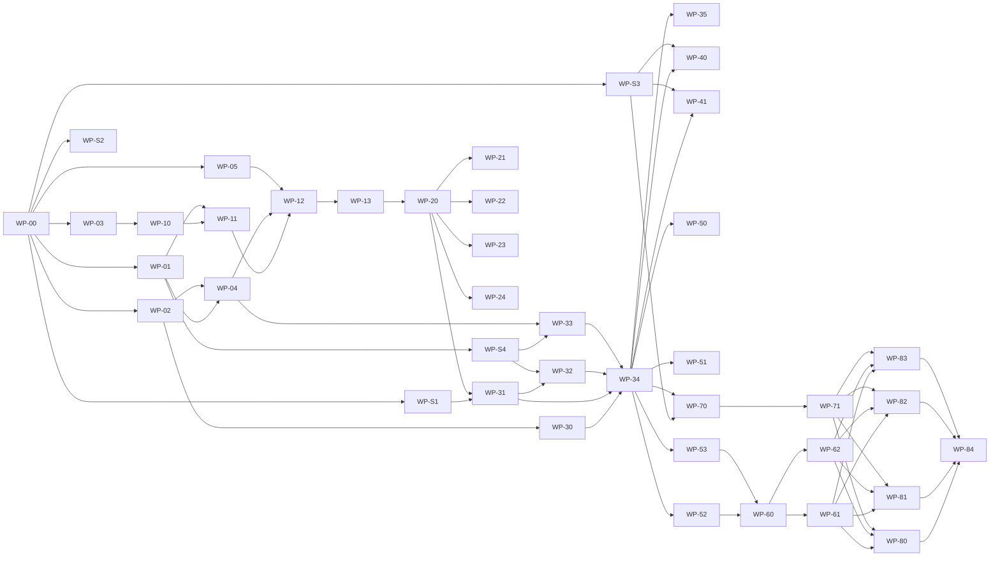

# Family Xpense: Backlog

Epics map to milestones M0 to M8. Each story lists acceptance criteria, an estimate and the work package that delivers it ([DELEGATION.md](DELEGATION.md)).

Estimates are for one Opus 5.5 session with review: **S** up to half a day, **M** one to two days, **L** three to five days.

## Milestones

| Milestone | Outcome | Exit test |
|---|---|---|
| **M0** Setup | repo, CI, two Firebase projects, shared core, design system, server skeleton, rules, four spikes answered | CI green on all jobs; server deployed to `xpense-dev`; spike reports merged |
| **M1** Auth, household, accounts | two people sign in, share a household, add accounts | partner joins by code on a second simulator; private account is invisible to them |
| **M2** Manual entry and Activity | entries by form, Activity, Home, FX | 20 mixed-currency entries by form; balances and Home totals correct; undo works offline |
| **M3** AI text capture | hybrid text capture through all three paths | evaluation gates pass for typed English; same card from local and agent paths (golden-identical) |
| **M4** Voice and receipts | talk and scan | English and Arabic voice on device; Kurdish through cloud; receipt total read and saved |
| **M5** Loans, goals, budgets, recurring | the rest of the money model | loan lifecycle by chat; budget warning fires; recurring offered and posted |
| **M6** Proactive agent and reports | jobs, notifications, monthly report | scheduled nudge arrives as a push and opens a card; report exports to PDF and Excel |
| **M7** On-device privacy mode | On-device only mode | egress test passes; captures complete with no AI network call |
| **M8** Polish and launch | localisation, quick capture, deletion, store | rendered design review signed off; App Store submission accepted |

MVP for the two partners is M0 to M4 plus loans from M5.

## E0. Setup (M0)

| ID | Story | Acceptance criteria | Est | Depends | WP |
|---|---|---|---|---|---|
| S0.1 | Monorepo and tooling | `app/`, `server/`, `packages/xpense_shared/`, `firebase/`, `evals/` exist; Flutter pinned to 3.50.1 with `.fvmrc`; lint config shared; `flutter analyze` and `dart analyze` clean on empty projects; git initialised with `main` protected | S | | WP-00 |
| S0.2 | CI skeleton | path-filtered jobs `shared`, `app`, `server`, `rules` run on PRs and pass | S | S0.1 | WP-00 |
| S0.3 | Cloud projects | `xpense-dev` and `xpense-prod` exist with Firestore (chosen region), Auth providers, App Check, Storage, Secret Manager secret, service accounts; emulator suite runs locally; no command touches the pre-existing gcloud project | M | S0.1, owner | WP-01 |
| S0.4 | Money core | `Money`, `Currency` (USD 2, IQD 0), `allocate()`, FX conversion with string rates, digit folding; property tests for allocate; verified vectors pass | M | S0.1 | WP-02 |
| S0.5 | Shared schemas | `EntryDraft` and related schemantic types generate and round-trip; taxonomy constants; default category tree | S | S0.4 | WP-02 |
| S0.6 | Design tokens and theme | light and dark themes from DESIGN_SYSTEM; contrast unit test passes; raw-value gate in CI; fonts bundled and licensed | M | S0.1 | WP-03 |
| S0.7 | `GlassSurface` | six variants, four tiers, Reduce Transparency through the platform channel, Increase Contrast; goldens for tiers 0 and 1 | M | S0.6 | WP-03 |
| S0.8 | Core UI components and gallery | every component in DESIGN_SYSTEM 8 has a gallery entry and goldens (light, dark, LTR, RTL, scale 1.0 and 1.5) | L | S0.6 | WP-03 |
| S0.9 | Server skeleton | `GenkitRouter` with role switch, `/healthz`, context provider verifying ID token and App Check, admin gateway, Dockerfile; runs under `genkit start`; deployed to `xpense-dev` as two services | M | S0.1, S0.3 | WP-04 |
| S0.10 | Rules and indexes | rules and indexes from DATA_MODEL; emulator test suite covers every bullet in DATA_MODEL 5 | M | S0.1 | WP-05 |
| S0.11 | Spike: A2UI round trip | report answers every "verify in WP-S1" item; sample agent renders a custom component in a Flutter app; local messages render the same widget | M | S0.1 | WP-S1 |
| S0.12 | Spike: glass performance | frame timings for tiers 1 to 3 on the oldest available iPhone and a current one; recommended device table | S | S0.1 | WP-S2 |
| S0.13 | Spike: on-device capability | on a real iPhone: Apple model availability and languages, Gemma 4 E2B load time and memory, Arabic and Kurdish extraction on 30 sample utterances, on-device Arabic speech, Vision OCR on Arabic-script receipts | M | S0.1, owner's phone | WP-S3 |
| S0.14 | Spike: Decisions API and Kurdish audio | question set runs against real categories; accuracy and calibration on 60 utterances (EN, AR, CKB); measured tokens per call; Gemini transcription of 10 Sorani clips scored | M | S0.3 | WP-S4 |

## E1. Auth, household, accounts (M1)

| ID | Story | Acceptance criteria | Est | Depends | WP |
|---|---|---|---|---|---|
| S1.1 | App shell | startup order per ARCHITECTURE 3.3; four tabs plus Ask route; theme restored before first paint; ARB files for `en`, `ckb`, `ar` with RTL switching | M | S0.6, S0.8 | WP-10 |
| S1.2 | Face ID lock | optional lock on cold start and after 60 s in background; content hidden in the app switcher; fallback to passcode | S | S1.1 | WP-10 |
| S1.3 | Welcome and sign-in | screens 1 and 2; Apple, Google and email sign-in work against the emulator and `xpense-dev`; errors are shown inline | M | S1.1, S0.3 | WP-11 |
| S1.4 | Create household | screen 3 creates `households/{hid}`, the member document and the default categories in one batch | S | S1.3, S0.10 | WP-12 |
| S1.5 | Invite and join | invite code (10 characters, 7 days, single use) and link; partner joins through `/household/join`; third join attempt is refused; rate limited | M | S1.4, S0.9 | WP-12 |
| S1.6 | Accounts | add, edit, archive; kinds and currencies; opening balance creates an `adjustment`; screens 4 and 10 | M | S1.4, S0.4 | WP-13 |
| S1.7 | Account privacy | personal accounts private by default; sharing switch; partner sees nothing of a private account in any list or total; rules tests prove it | M | S1.6 | WP-13 |
| S1.8 | Visibility backfill | flipping sharing triggers the server event; `visibleTo` on transactions is rewritten; UI shows "Sharing…" until done | S | S1.7, S0.9 | WP-13 |

## E2. Manual entry and Activity (M2)

| ID | Story | Acceptance criteria | Est | Depends | WP |
|---|---|---|---|---|---|
| S2.1 | Transaction write path | batched write with balance increments; revisions on edit; soft delete with reversing increments; works offline; unit tests for every type in DATA_MODEL 3 | L | S1.6 | WP-20 |
| S2.2 | Add manually | screen 9 for expense, income, transfer and loan; currency follows the account; validation messages next to fields | M | S2.1 | WP-21 |
| S2.3 | Entry detail, edit, history | screen 17; edit any field; history lists revisions with Restore | M | S2.1 | WP-21 |
| S2.4 | Activity | screen 16; day groups with net; filters; search over the cached window; swipe actions with undo; empty, loading, offline states | M | S2.1 | WP-22 |
| S2.5 | Home | screen 6 with live totals for the viewer's visible data; daily bars; recent list; nudge row placeholder | M | S2.1 | WP-23 |
| S2.6 | FX rates | daily job writes official rates; household chooses official or market; market rate entered by a member; every non-base transaction stores pair, rate, source and base amount; stale-rate prompt after 7 days | M | S2.1, S0.9 | WP-24 |
| S2.7 | Categories editor | rename, add, reorder, archive; names in three languages | S | S2.2 | WP-24 |

## E3. AI text capture (M3)

| ID | Story | Acceptance criteria | Est | Depends | WP |
|---|---|---|---|---|---|
| S3.1 | Fast parser | AI_PIPELINE 5 implemented; table tests in three languages; 99% amount and currency on the single-entry slice | L | S0.4 | WP-30 |
| S3.2 | Catalog JSON and parity | `xpense_catalog.json` matches A2UI_CATALOG 3; parity test green | S | S0.11 | WP-31 |
| S3.3 | Catalog widgets | all 24 components implemented; goldens from shared fixtures; `EntryList` save, undo, pick, validation flows widget-tested | L | S3.2, S0.8, S2.1 | WP-31 |
| S3.4 | Surface host and action routing | `XpenseSurfaceHost` per A2UI adapter rules; local and remote messages share one thread; bad message does not stop a turn | M | S3.3 | WP-31 |
| S3.5 | Local surface builder | `captureSurface` and friends in `xpense_shared`; fixtures shared with goldens | S | S3.2 | WP-31 |
| S3.6 | Agent | `xpenseAgent` with tools, prompts, middleware; sessions in Firestore; strict validation in dev; traces visible in the Developer UI | L | S0.9, S0.11, S3.2 | WP-32 |
| S3.7 | `/decide` proxy | question set built server-side; fallback chain; cache; usage counters | M | S0.9, S0.14 | WP-33 |
| S3.8 | Router | decision table in AI_PIPELINE 2 as a pure function with a test per row; reason codes logged | S | S3.1 | WP-34 |
| S3.9 | Ask screen, text | screen 7 with typed capture end to end through paths L, D and A; mode chip; busy and error states | M | S3.4, S3.6, S3.7, S3.8 | WP-34 |
| S3.10 | Confidence policy | thresholds from Remote Config; Guessed badge; follow-up order; save rules | S | S3.9 | WP-34 |
| S3.11 | Learning | a corrected guessed field creates or updates a rule; next identical merchant resolves on path L | S | S3.9 | WP-34 |
| S3.12 | Questions | "how much…" answers with figures from tools and a breakdown surface | M | S3.6 | WP-32 |
| S3.13 | Evaluation harness | flows, evaluators and CI job from AI_PIPELINE 11; dataset of at least 182 utterances; thresholds tuned; measured cost table replaces estimates | L | S3.6, S3.7, S3.1 | WP-35 |
| S3.14 | Duplicate hint | deterministic candidates plus the `duplicate` question; warning on the slip | S | S3.7 | WP-33 |

## E4. Voice and receipts (M4)

| ID | Story | Acceptance criteria | Est | Depends | WP |
|---|---|---|---|---|---|
| S4.1 | Voice on device | hold or tap to talk; live waveform; English and Arabic transcripts on device where supported; permission pre-prompt | M | S3.9, S0.13 | WP-40 |
| S4.2 | Voice through cloud | Kurdish (and unsupported cases) send audio to the agent; transcript shown and editable; blocked with a clear message in On-device mode | M | S4.1, S3.6 | WP-40 |
| S4.3 | Receipt scan | camera, capture, Vision OCR, receipt parser; total, merchant, date read; sheet with one entry | L | S3.9, S0.13 | WP-41 |
| S4.4 | Receipt split | line items grouped by category (cloud in Smart and Cloud); switch regroups with exact sums; "Save n entries" | M | S4.3, S3.6 | WP-41 |
| S4.5 | Receipt storage | images stay on the phone; optional backup to Storage with rules | S | S4.3 | WP-41 |

## E5. Loans, goals, budgets, recurring (M5)

| ID | Story | Acceptance criteria | Est | Depends | WP |
|---|---|---|---|---|---|
| S5.1 | Loans and debts | screens 14 and 15; lend, borrow, repay by form and by chat; outstanding maintained; closes at zero; due date and reminder fields | L | S2.1, S3.3 | WP-50 |
| S5.2 | Loan intent follow-up | "Gave Alex 300" asks loan, gift or repayment and files accordingly | S | S5.1, S3.9 | WP-50 |
| S5.3 | Goals | screens 12 and 13; goal backed by a savings account; "move 200 to the trip fund" works by chat | M | S2.1, S3.3 | WP-51 |
| S5.4 | Budgets | screen 18; monthly limits per category and total; saved line shows budget progress; threshold event writes a notification | M | S2.1 | WP-52 |
| S5.5 | Recurring | offer after a likely recurring entry; templates with auto, remind, off; list and edit in Settings | M | S3.9 | WP-53 |

## E6. Proactive agent and reports (M6)

| ID | Story | Acceptance criteria | Est | Depends | WP |
|---|---|---|---|---|---|
| S6.1 | Jobs platform | scheduler targets for every job; IAM-only access; idempotent runs; structured logs | M | S0.9 | WP-60 |
| S6.2 | Nudges | missed bill, budget warning, loan due, stale rate; at most two nudges per member per day; dedupe keys | M | S6.1, S5.4, S5.5 | WP-60 |
| S6.3 | Recurring detection and posting | detection over 3 months of history; `auto` items posted by the server with `source: recurring` | M | S6.1, S5.5 | WP-60 |
| S6.4 | Reconcile and retention | nightly reconcile corrects seeded drift in a test; retention deletes old sessions | S | S6.1 | WP-60 |
| S6.5 | Push and notification centre | FCM tokens per device; screen 19; tapping a push opens a locally built card; permission asked in context | M | S6.2, S1.1 | WP-61 |
| S6.6 | Monthly report | screen 22; numbers computed in code; narration by Flash when allowed, template otherwise; in the member's language | M | S6.1 | WP-62 |
| S6.7 | Export and import | PDF and Excel report export, CSV export of entries, CSV import with a mapping step | M | S6.6 | WP-62 |

## E7. On-device privacy mode (M7)

| ID | Story | Acceptance criteria | Est | Depends | WP |
|---|---|---|---|---|---|
| S7.1 | On-device engines | `OnDeviceLlm` with Apple model and Gemma engines; capability by language; model download with progress, Wi-Fi only | L | S0.13, S3.9 | WP-70 |
| S7.2 | Privacy settings | three modes with plain descriptions; server refuses AI routes for On-device members; `cloudInsights` follows | S | S7.1 | WP-70 |
| S7.3 | Local pickers path | with no model, capture completes through parser, rules and pickers | S | S3.9 | WP-70 |
| S7.4 | Egress test | automated test proves no AI network call in On-device mode | S | S7.2 | WP-71 |
| S7.5 | Offline queue | complex captures made offline are queued locally and resolved when online; a notification says they are ready | M | S3.9 | WP-71 |
| S7.6 | On-device evaluation | integration test runs the single-entry slices on a real iPhone and reports scores | S | S7.1, S3.13 | WP-71 |

## E8. Polish, localisation, launch (M8)

| ID | Story | Acceptance criteria | Est | Depends | WP |
|---|---|---|---|---|---|
| S8.1 | Quick capture | App Shortcut "Log an expense" with a text parameter; home and lock screen widgets (balance, quick add); share extension for receipt images | L | S3.9, S4.3 | WP-80 |
| S8.2 | Localisation complete | all strings in `ckb` and `ar` reviewed by a native speaker; local digits setting; RTL goldens for every screen | L | all screens | WP-81 |
| S8.3 | Account deletion and data export | in-app deletion through `/account/delete`; export of all visible data as a zip of CSV and JSON | M | S0.9 | WP-82 |
| S8.4 | Legal and store | Terms, Privacy Policy, App Store privacy labels, screenshots in three languages, review notes with a demo account | M | owner | WP-82 |
| S8.5 | Observability and cost controls | OTLP traces in Cloud Trace without content; usage counters and limits live; budget alert on the GCP project; Firestore point-in-time recovery and a weekly export | M | S0.9 | WP-83 |
| S8.6 | App Check enforcement | enforcement on for Firestore, Storage and the server in `xpense-prod`; debug tokens removed | S | S8.5 | WP-83 |
| S8.7 | Rendered design review | every screen on a small and a large iPhone, light and dark, RTL, largest text size, Reduce Motion and Reduce Transparency; findings fixed in one round | L | all screens | WP-84 |
| S8.8 | Performance pass | cold start under 2.5 s and 60 fps scrolling with glass on iPhone 12; glass tier table final | M | S8.7 | WP-84 |

## Later (not scheduled)

Android release; partner settle-up; Hijri calendar display; iPad layout; more currencies with live rates; bank or SMS import; Apple Watch; more than two members; on-device answers to open questions.

## Dependency overview

